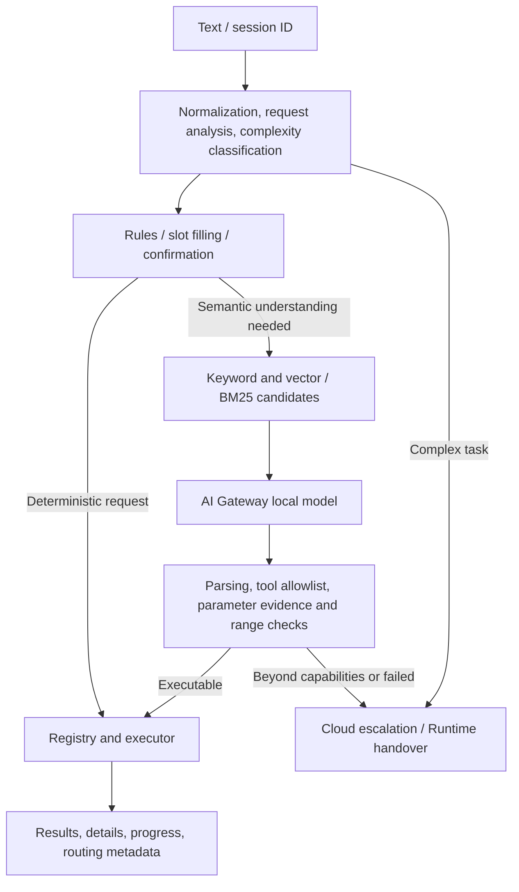

# Bibit Intent Design

[中文](design.md)

## 1. Purpose and implementation scope

Bibit Intent is a Python intent-routing and tool-execution component for Bianbu Linux / SpacemiT RISC-V devices. Developers can also study and test it on development machines. The current implementation targets Linux systems capable of running Python 3.11+, desktop tools, and a separate inference service; it is not MCU firmware. Its input interfaces accept text. Speech recognition belongs to the upstream integration.

The goal is to handle deterministic requests on the device first, use a local model for natural language understanding, and escalate requests beyond local capabilities to the cloud. Rules and offline tests require no model service. Local inference and vector retrieval require a compatible AI Gateway and registered models. Cloud features require separate connectivity and credentials.

This document describes the current main branch. Historical experimental figures are not performance guarantees. The default local context setting is 512 tokens, rather than a universal hardware limit. Measure latency, memory, and routing accuracy with the actual device, models, and corpus.

## 2. Architecture and request flow



Entry points include the standalone CLI, `EmbeddedBibitPipeline`, HTTP service, and MCP stdio service. They reuse the registry and executor but have different responsibilities: the routing pipeline decides whether to handle a request locally, while MCP accepts tools selected by its caller without repeating natural language routing.

### 2.1 Rules and complex intents

`routing/rule_engine.py` loads matching rules, slots, and mappings from tool declarations. `analysis/`, `core/request_semantics.py`, and `routing/complexity.py` provide deterministic request analysis. Complexity classification uses signals such as length, conjunctions, punctuation, verbs, and questions, with configurable thresholds. Complex tasks and requests with multiple actions have escalation paths; matching one keyword does not imply that the whole request has been completed.

`routing/intent.py` organizes candidate decisions. `routing/router.py` implements final branches, validation before execution, and fallback. Route stages include `rule`, `local`, `cloud`, `slot_fill`, and `confirm`; the latter two represent session interaction states.

### 2.2 Local semantics and models

`routing/embedding.py` combines vector and BM25 candidate retrieval over routing corpora. `question_detector.py` helps distinguish questions from actions. Candidates narrow the model's tool list and do not by themselves indicate execution. Router branches control deterministic fallback after model failure.

`models/backends.py` currently accepts only the `ai_gateway` backend. `models/gateway.py` supplies local language-model, embedding, and lifecycle clients. Defaults are `glm-edge-1.5b-chat-q4_0`, `qwen3-embedding-0.6b-q4_0`, and `http://127.0.0.1:18790`. Model IDs are configurable and must match Gateway registrations.

The local client uses a compact `CALL` / `ESCALATE` protocol and grammar constraints to reduce parsing ambiguity. Grammar constrains output form; it does not guarantee correct tool selection, parameter meaning, or authorization. Soft confidence gates default to `shadow`, observing scores and decisions rather than enforcing a default blocking policy.

### 2.3 Cloud and Runtime boundaries

The standalone CLI can use the cloud client in `models/cloud_model.py`. `AgentConfig` supplies cloud settings, including `CLOUD_API_KEY`, `CLOUD_BASE_URL`, and `CLOUD_MODEL`. Explicitly configure your own provider and model.

The embedded pipeline handles local capabilities and returns `PipelineOutcome.handled`, `route`, `reason`, and `metadata` to its integrator. Runtime decides whether to send unhandled requests to the cloud. The HTTP service wraps this local pipeline rather than implementing a complete cloud Agent. Offline operation, unavailable models, and invalid output produce explicit results or escalation reasons, rather than being treated as success.

## 3. Tools, execution, and sessions

`core/registry.py` reads `resources/tools.yaml`. `execution/skill_loader.py` loads `resources/skills/*/skill.yaml` and handlers. Declarations include parameter definitions, routing descriptions, and confirmation attributes. The same registry provides compact local descriptions and MCP tool schemas.

Router checks that tools are permitted candidates and validates parameter types, ranges, and evidence in the user's text. Explicit values can proceed; missing required parameters trigger a follow-up question. Uncertain model-inferred values can require confirmation. `core/session.py` manages pending slots and confirmations. The embedded pipeline isolates session state, bounds the number of sessions, and serializes processing within each session.

`execution/executor.py` dispatches calls. Results carry messages, details, and success status; plain command output and Markdown details have distinct presentation contracts. `execution/cancellation.py` works with bounded command execution for cancellation and deadlines. Progress uses bridge mechanisms. External tool availability and results must be checked.

Capabilities include audio and brightness, applications and windows, displays, Wi-Fi / Bluetooth, system diagnostics, package management, file and knowledge retrieval, document templates, CLI-Anything application adapters, and schedule reminders. Packaged tool and skill declarations define actual coverage.

The schedule skill invokes external `lxqt-schedule-ctl` for creation, queries, updates, and deletion. Current behavior includes date / range queries, updates by title, repeat clearing, conflict markers, and time resolution. The external scheduler owns storage and notifications.

CLI-Anything integration includes application registration, action declarations, prerequisite checks, artifact validation, and auditing. Corresponding applications and harnesses must be installed. A zero process exit code does not replace artifact validation. Knowledge retrieval includes local BM25 and knowledge-source adapters; this repository does not supply every external retrieval service or application.

## 4. Public interfaces

| Interface | Entry point and purpose |
| --- | --- |
| CLI | `bibit-intent`: interactive mode, single requests, `--selftest` |
| Python | `EmbeddedBibitPipeline.from_package(data_root=..., settings=...)` |
| HTTP | `bibit-intent serve`: defaults to `127.0.0.1:8765`, supports Unix sockets |
| MCP | `python -m bibit_intent.mcp_server`: stdio tool service |

HTTP endpoints are `POST /v1/runs`, `DELETE /v1/runs/{run_id}`, `DELETE /v1/sessions/{session_id}`, `GET /v1/models`, `POST /v1/models/{model_type}/{action}`, `GET /healthz`, and `GET /metrics`. See `server.py` and `client.py` for fields and validation. Gateway clients delegate model download and start / stop actions.

MCP annotations for dangerous tools support Runtime approval. Callers must enforce that policy; MCP does not share the natural language Router's multi-turn confirmation flow. Use loopback binding or a socket with controlled permissions for HTTP. Exposing it externally requires access control supplied by the integrator.

## 5. Configuration and deployment

Configuration lives in `config.py` and `pipeline.py`. CLI `AgentConfig` supports environment variables and `.env`; `PipelineSettings.from_environment()` reads environment variables directly. Keep these sources consistent when integrating.

| Setting | Default / meaning |
| --- | --- |
| `BIBIT_INTENT_INFERENCE_BACKEND` | `ai_gateway` |
| `BIBIT_INTENT_GATEWAY_URL` | `http://127.0.0.1:18790` |
| `BIBIT_INTENT_GATEWAY_LLM_MODEL` | `glm-edge-1.5b-chat-q4_0` |
| `BIBIT_INTENT_GATEWAY_EMBED_MODEL` | `qwen3-embedding-0.6b-q4_0` |
| `BIBIT_INTENT_GATEWAY_API_KEY` | Optional Gateway credential |
| `BIBIT_INTENT_GATEWAY_EMBED_REVISION` | `1`, identifies the embedding cache |
| `BIBIT_INTENT_CONTEXT_LIMIT` | Embedded pipeline default: `512` |
| `BIBIT_INTENT_LOCAL_TIMEOUT_SECONDS` | Embedded pipeline default: `20` |
| `BIBIT_INTENT_MAX_SESSIONS` | Embedded pipeline default: `256` |
| `BIBIT_INTENT_COMPLEXITY_*` | Complexity thresholds; see `complexity.py` |

Development machines may use pip or uv. Target riscv64 devices use `deploy/deploy.sh`, `requirements.txt`, and platform-compatible wheels rather than the development uv lockfile. `debian/` and `packaging/` provide packaging resources. Install and configure Gateway separately, and explicitly register / download models. Installing the Python package does not imply model readiness. See `deploy/ai-gateway-bibit.yaml` for a deployment example.

Desktop control depends on the target desktop session, system commands, and permissions. Do not assume every hardware or desktop tool is available on a development machine. Verify the environment before executing real control requests.

## 6. Learning, validation, and extension

```bash
python3 -m venv .venv
.venv/bin/pip install -e .
.venv/bin/bibit-intent --selftest
# After configuring Gateway and preparing models:
.venv/bin/bibit-intent '把音量调到60'
# Local HTTP service:
.venv/bin/bibit-intent serve --data-root /tmp/bibit-intent
```

Tests include standalone `tests/test_*.py` self-tests, pytest cases, and evaluation entry points such as `tests/regression.py`. Some historical self-tests use `run()`; pytest collection counts do not represent all coverage. Read tests by module and distinguish mocked tests from real-service and real-device tests. Tests that modify the system require a suitable environment.

Suggested reading order: `resources/tools.yaml` → `core/registry.py` → `routing/rule_engine.py` / `intent.py` → `routing/router.py` → `execution/executor.py` → `pipeline.py` / `server.py` / `mcp_server/server.py`.

To add a capability, declare its tool and parameters, register its handler, add Chinese and English routing examples and negative cases, and verify missing slots, confirmation, errors, cancellation, and offline behavior. When changing models, check Gateway interfaces, output constraints, and embedding cache identity together.

## 7. Security and research considerations

Treat tool output, retrieved text, and model output as untrusted data. Tool allowlists, parameter evidence, range checks, and confirmation are distinct controls. GBNF alone cannot prevent semantic prompt injection or unauthorized actions. Cloud transfer and redaction policies depend on CLI configuration and Runtime integration; the implementation does not guarantee uniform automatic redaction for all requests.

Dependency downloads, package installation, desktop control, and arbitrary-command capabilities have different permission boundaries. Use only necessary privileges and protect `.env` and API credentials. Sharing source does not itself grant an open-source license; check repository and dependency licensing before reuse, redistribution, or using third-party resources.
