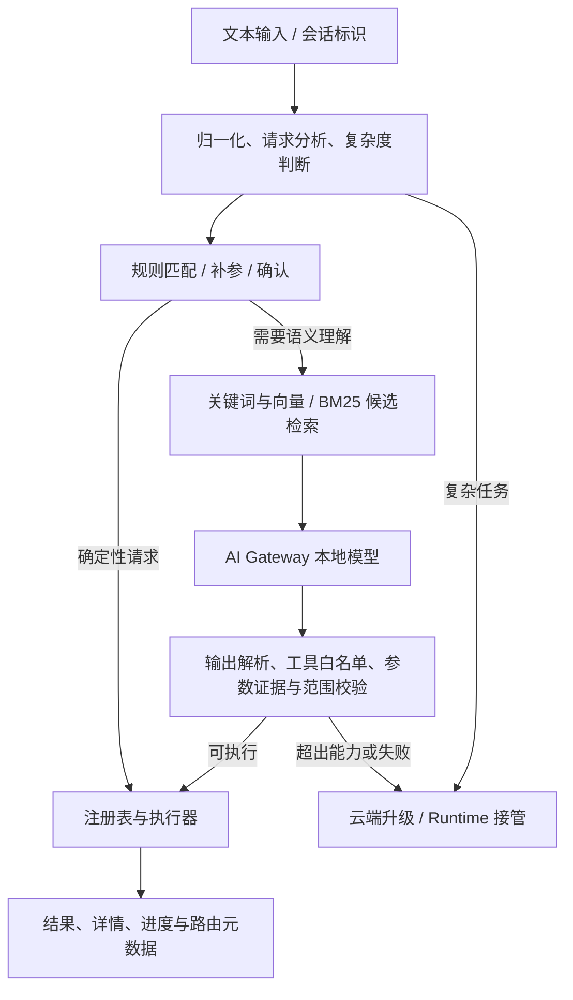

# Bibit Intent 设计文档

[English](design.en.md)

## 1. 项目定位与实现边界

Bibit Intent 是面向 Bianbu Linux / SpacemiT RISC-V 设备的 Python 意图路由与工具执行组件，也可以在开发机上学习和测试。当前代码面向可运行 Python 3.11+、桌面工具及独立推理服务的 Linux 系统，并非 MCU 固件。输入接口是文本；语音识别由上游接入方提供。

核心目标是优先在设备上处理确定性请求，再使用本地模型理解口语，最后将超出本地能力的请求交给云端。规则和离线测试不要求模型服务；本地推理与向量检索需要兼容的 AI Gateway 和已注册的模型；云端功能需要单独配置网络与凭据。

本文描述当前 main 分支实现，不把早期实验指标当作性能承诺。512 Token 是默认本地上下文配置，不是所有部署的硬件限制；延迟、内存和命中率应在实际设备、模型及语料上测量。

## 2. 架构与请求流程



入口包括独立 CLI、`EmbeddedBibitPipeline`、HTTP 服务和 MCP stdio 服务。它们复用注册表及执行器，但职责不同：路由流水线决定是否本地处理；MCP 接受调用方选择的工具调用，不重新执行自然语言路由。

### 2.1 规则与复杂意图

`routing/rule_engine.py` 从工具声明加载匹配规则、槽位及映射；`analysis/`、`core/request_semantics.py` 和 `routing/complexity.py` 提供确定性请求分析。复杂度判断利用长度、连接词、标点、动词及问句等信号，阈值可配置。复杂任务和多动作请求存在升级路径，不能因为某个局部关键词命中就假定完整请求已完成。

`routing/intent.py` 组织候选判断，`routing/router.py` 实现最终分支、执行前校验和降级。路由结果包含 `rule`、`local`、`cloud`、`slot_fill`、`confirm` 阶段；后两者表示会话交互状态。

### 2.2 本地语义与模型

`routing/embedding.py` 利用路由语料进行向量与 BM25 混合候选检索；`question_detector.py` 辅助区分问答和操作。候选信号用于缩小模型工具清单，不单独意味着已执行工具。模型失败后的确定性兜底由 Router 分支控制。

`models/backends.py` 当前只接受 `ai_gateway` 后端。`models/gateway.py` 提供本地模型、embedding 和模型生命周期客户端。默认语言模型为 `glm-edge-1.5b-chat-q4_0`，默认向量模型为 `qwen3-embedding-0.6b-q4_0`，服务地址为 `http://127.0.0.1:18790`；这些是可更换的模型 ID，必须与 Gateway 注册信息一致。

本地客户端使用紧凑 `CALL` / `ESCALATE` 协议和语法约束减少解析歧义。语法约束保证输出形式，不保证工具选择、参数含义或授权正确。软置信门控默认采用 `shadow`，观察分数与判断，不能把它描述为默认强制拦截策略。

### 2.3 云端与 Runtime 边界

独立 CLI 可通过 `models/cloud_model.py` 使用云端客户端。云端配置来自 `AgentConfig`，包括 `CLOUD_API_KEY`、`CLOUD_BASE_URL` 和 `CLOUD_MODEL`。应显式选择自己的服务和模型。

嵌入式流水线只负责本地能力，使用 `PipelineOutcome.handled`、`route`、`reason` 和 `metadata` 把结果交给接入方；未处理请求由 Runtime 决定是否云端接管。HTTP 服务也是本地流水线封装，不承担完整云端 Agent 编排。离线、模型不可用或输出无效时返回明确结果或升级原因，不视为成功。

## 3. 工具、执行与会话

`core/registry.py` 读取 `resources/tools.yaml`，`execution/skill_loader.py` 加载 `resources/skills/*/skill.yaml` 和处理器。声明包含参数定义、路由描述及确认等属性；同一注册表提供本地精简描述和 MCP 工具 schema。

Router 校验工具是否在允许候选内，并核对参数类型、取值范围及原文证据。明确值可执行，缺失的必填参数进入追问；不确定的模型推测值可挂起确认。`core/session.py` 管理待补参数与确认状态。嵌入式流水线按会话隔离状态，限制会话数量，并串行化同一会话的处理。

`execution/executor.py` 分发调用，结果携带消息、详情及成功状态；文本命令输出与 Markdown 详情有不同的呈现约定。取消与超时由 `execution/cancellation.py` 和有界命令执行配合，进度由进度桥接机制传递。外部工具可用性和返回结果都需要检查。

主要能力包括音量与亮度、应用和窗口、显示、Wi-Fi / 蓝牙、系统诊断、软件包管理、文件与知识检索、文档模板、CLI-Anything 应用适配，以及日程提醒。具体覆盖以随包工具和 skill 声明为准。

日程 skill 调用外部 `lxqt-schedule-ctl`，支持创建、查询、更新和删除等操作，当前实现包括日期 / 范围查询、按标题更新、清除重复规则、冲突标记和时间解析。日程存储与通知由外部日程组件承担。

CLI-Anything 集成包括应用注册、动作声明、依赖检查、产物验证及审计。需要安装对应应用和 harness；进程退出码为零不能替代产物有效性检查。知识检索同时包含本地 BM25 和知识源适配，外部检索服务及应用不由本仓库全部提供。

## 4. 对外接口

| 接口 | 入口与用途 |
| --- | --- |
| CLI | `bibit-intent`：交互式、单次文本、`--selftest` |
| Python | `EmbeddedBibitPipeline.from_package(data_root=..., settings=...)` |
| HTTP | `bibit-intent serve`：默认 `127.0.0.1:8765`，支持 Unix socket |
| MCP | `python -m bibit_intent.mcp_server`：stdio 工具服务 |

HTTP 服务提供 `POST /v1/runs`、`DELETE /v1/runs/{run_id}`、`DELETE /v1/sessions/{session_id}`、`GET /v1/models`、`POST /v1/models/{model_type}/{action}`、`GET /healthz` 和 `GET /metrics`。协议字段与校验逻辑见 `server.py`、`client.py`；模型下载、启停等动作由 Gateway 客户端代理。

MCP 的危险工具注解供 Runtime 审批使用。调用方须正确执行审批策略；不能假定 MCP 与自然语言 Router 具有相同的多轮确认流程。HTTP 服务应使用回环地址或权限受控的 socket，对外开放需要接入方提供访问控制。

## 5. 配置与部署

核心配置实现位于 `config.py` 和 `pipeline.py`。CLI 的 `AgentConfig` 支持环境变量与 `.env`；`PipelineSettings.from_environment()` 直接读取环境变量，接入时应保持一致。

| 配置 | 默认 / 说明 |
| --- | --- |
| `BIBIT_INTENT_INFERENCE_BACKEND` | `ai_gateway` |
| `BIBIT_INTENT_GATEWAY_URL` | `http://127.0.0.1:18790` |
| `BIBIT_INTENT_GATEWAY_LLM_MODEL` | `glm-edge-1.5b-chat-q4_0` |
| `BIBIT_INTENT_GATEWAY_EMBED_MODEL` | `qwen3-embedding-0.6b-q4_0` |
| `BIBIT_INTENT_GATEWAY_API_KEY` | 可选 Gateway 凭据 |
| `BIBIT_INTENT_GATEWAY_EMBED_REVISION` | `1`，用于向量缓存身份 |
| `BIBIT_INTENT_CONTEXT_LIMIT` | 嵌入式流水线默认 `512` |
| `BIBIT_INTENT_LOCAL_TIMEOUT_SECONDS` | 嵌入式流水线默认 `20` |
| `BIBIT_INTENT_MAX_SESSIONS` | 嵌入式流水线默认 `256` |
| `BIBIT_INTENT_COMPLEXITY_*` | 复杂意图阈值，见 `complexity.py` |

开发机可使用 pip 或 uv；目标 riscv64 设备使用 `deploy/deploy.sh`、`requirements.txt` 和适配平台的 wheel，不依赖开发机的 uv 锁文件。`debian/`、`packaging/` 提供打包资源。Gateway 需单独安装和配置，模型需显式注册 / 下载；安装 Python 包不代表模型就绪。部署配置样例见 `deploy/ai-gateway-bibit.yaml`。

桌面控制依赖目标桌面会话、系统命令和权限；在普通开发机上不能假定所有硬件 / 桌面工具可用。运行真实控制请求前应确认对应环境。

## 6. 学习、验证与扩展

```bash
python3 -m venv .venv
.venv/bin/pip install -e .
.venv/bin/bibit-intent --selftest
# 配置 Gateway 并准备模型之后：
.venv/bin/bibit-intent '把音量调到60'
# 本地 HTTP 服务：
.venv/bin/bibit-intent serve --data-root /tmp/bibit-intent
```

测试包括可独立执行的 `tests/test_*.py` 自测脚本、pytest 用例及 `tests/regression.py` 等评估入口。部分历史自测使用 `run()`，pytest 收集数量不能代表全部覆盖。按模块阅读测试文件，并区分模拟测试、真实服务及真实设备测试；涉及系统更改的测试需要合适环境。

推荐阅读顺序：`resources/tools.yaml` → `core/registry.py` → `routing/rule_engine.py` / `intent.py` → `routing/router.py` → `execution/executor.py` → `pipeline.py` / `server.py` / `mcp_server/server.py`。

新增能力时声明工具及参数，注册处理器，补充中英文路由语料和正反例，并验证缺参、确认、错误、取消及离线行为。更换模型时同时核对 Gateway 接口、输出约束和向量缓存身份。

## 7. 安全与研究注意事项

工具输出、检索文本和模型输出都应视为不可信数据。工具白名单、参数证据、范围检查及确认是不同层的控制；GBNF 本身不能阻止语义层的提示注入或越权。云端传输和脱敏策略取决于 CLI 配置及 Runtime 接入，不能宣称所有请求都有统一的自动脱敏保证。

依赖下载、软件安装、桌面控制和任意命令能力具有不同权限边界，应使用最小必要权限并保护 `.env` / API 凭据。分享代码并不等于已授予开源许可；学习、再分发及第三方资源使用应核对仓库与依赖的许可条款。
